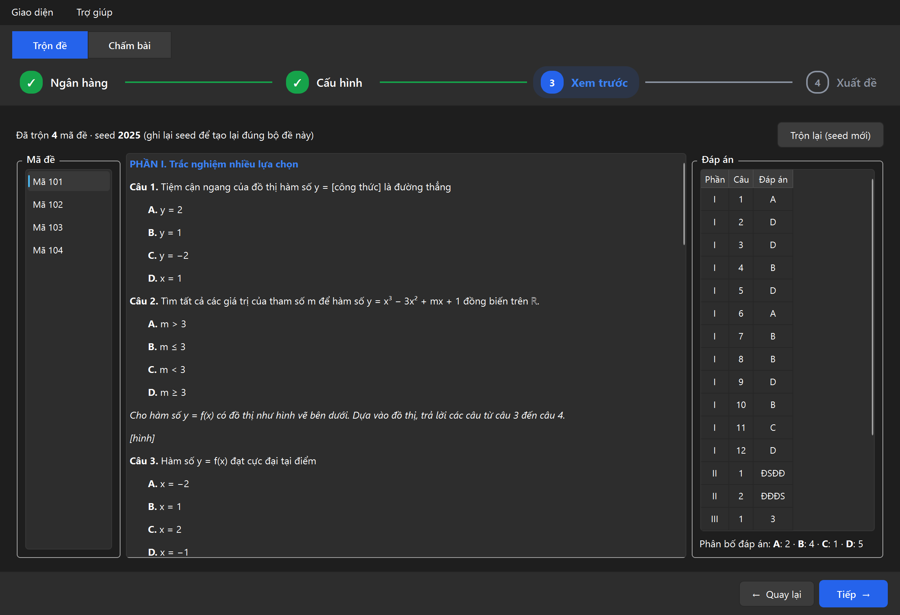
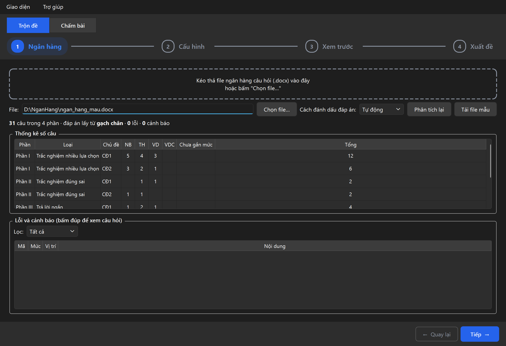
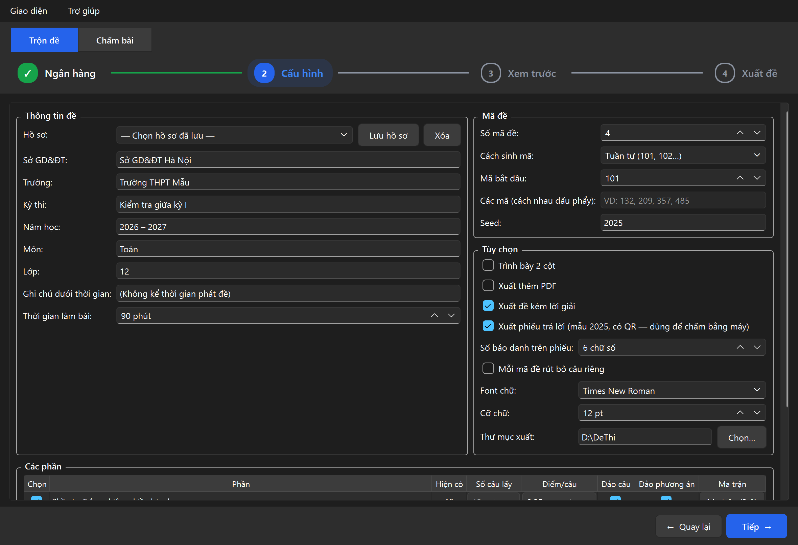
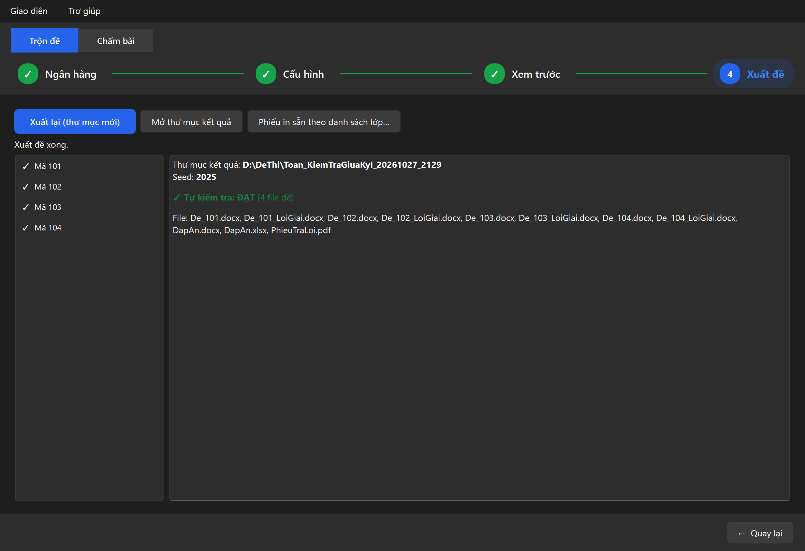
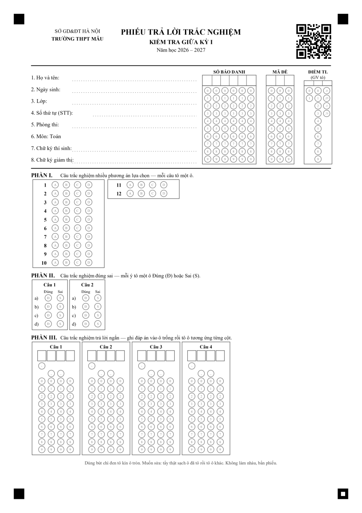
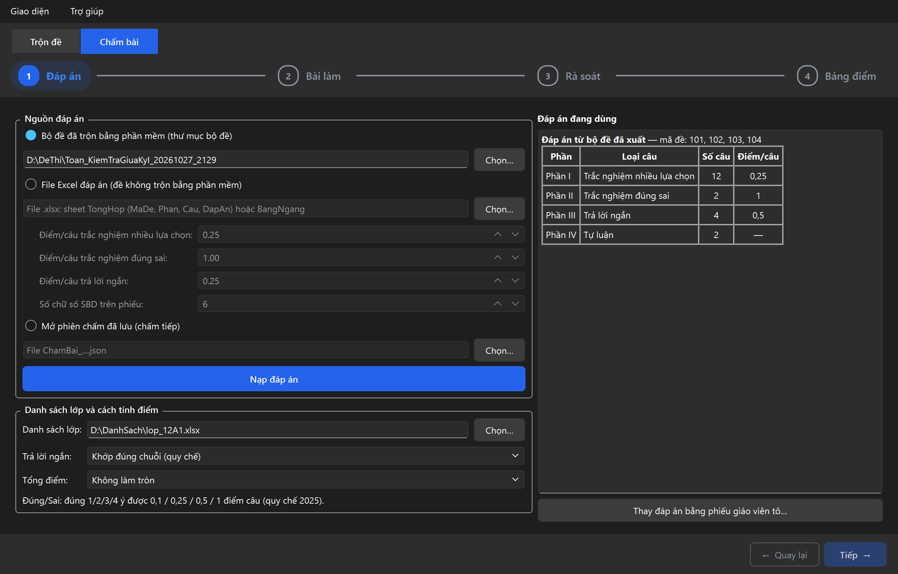
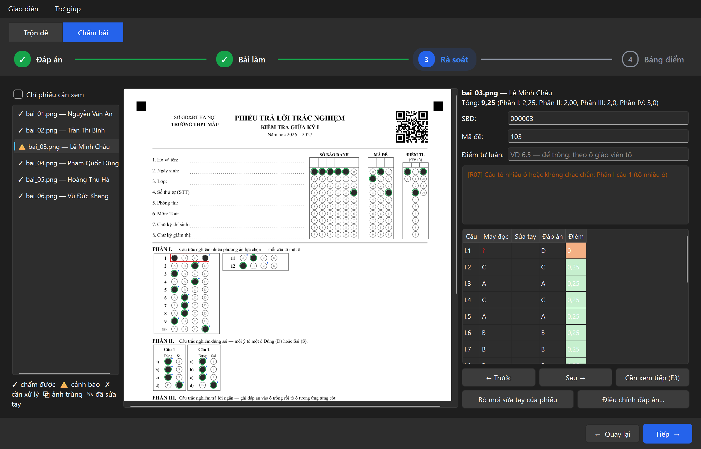
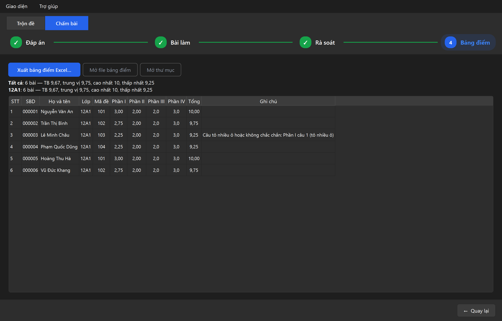

<div align="center">


# Trộn Đề QuizPVT — Phần mềm trộn đề và chấm bài trắc nghiệm THPT

**Trộn đề từ ngân hàng câu hỏi Word, giữ nguyên công thức MathType và hình ảnh.<br>
In phiếu trả lời mẫu 2025, chấm bài từ ảnh quét / ảnh chụp điện thoại, xuất bảng điểm Excel.<br>
Miễn phí, chạy offline.**

[](https://github.com/vantupham/tron-de-trac-nghiem/releases/latest)


[Tải về](#-tải-về-và-cài-đặt) · [Hướng dẫn nhanh](#-dùng-trong-4-bước) · [Chấm bài](#-chấm-bài-bằng-phiếu-trả-lời) · [Soạn ngân hàng câu hỏi](#-soạn-ngân-hàng-câu-hỏi) · [Câu hỏi thường gặp](#-câu-hỏi-thường-gặp) · [Liên hệ](#-tác-giả-và-liên-hệ)

</div>

---

<p align="center">
  
</p>

## ✨ Tính năng nổi bật

| | |
|---|---|
| 📝 **Đủ 4 dạng câu theo đề thi THPT mới** | Trắc nghiệm nhiều lựa chọn, đúng sai, trả lời ngắn, tự luận. Hỗ trợ câu chùm (nhiều câu chung một đoạn dẫn). |
| 🧮 **Giữ nguyên nội dung gốc** | Công thức MathType, Equation, hình ảnh, bảng, định dạng chữ được sao chép nguyên vẹn sang đề. |
| 🎯 **Rút câu theo ma trận** | Theo mức độ (NB/TH/VD/VDC), theo chủ đề, hoặc kết hợp cả hai. Các mã dùng chung một bộ câu, hoặc **mỗi mã rút bộ câu riêng** để chống nhìn bài. |
| 🔀 **Trộn linh hoạt** | Đảo câu, đảo phương án, đảo câu trong nhóm; khóa vị trí câu hoặc giữ thứ tự phương án theo từng câu; tự cân bằng phân bố đáp án A/B/C/D. |
| 📄 **Đề trình bày đúng mẫu** | Tiêu đề Sở/Trường – Kỳ thi, ô mã đề, "Trang x/y – Mã đề", 1 hoặc 2 cột, tự xếp phương án theo độ dài. |
| ✅ **Đáp án luôn đúng** | Sau khi xuất, phần mềm đọc lại từng file đề và đối chiếu với bảng đáp án. |
| 📊 **Đầy đủ file đáp án** | `DapAn.docx`, `DapAn.xlsx` (dùng cho phần mềm chấm), đề kèm lời giải, PDF (tùy chọn). |
| 🧾 **Phiếu trả lời mẫu 2025** | Tự tạo phiếu đúng số câu của đề, có mã QR; in sẵn họ tên và tô sẵn SBD theo danh sách lớp. |
| 📷 **Chấm bài từ ảnh** | Ảnh máy quét, ảnh chụp điện thoại hoặc file PDF gộp. Tự nắn ảnh nghiêng, lộn ngược, bóng đổ. Chỗ tô mơ hồ được đánh dấu để thầy cô xem lại, **không tự đoán**. |
| 📈 **Bảng điểm Excel** | Điểm từng phần theo danh sách lớp, chi tiết từng câu, phổ điểm, độ khó và độ phân biệt từng câu. |
| 🔒 **An toàn, riêng tư** | Chạy offline, không gửi dữ liệu đi đâu, không bao giờ sửa file ngân hàng gốc. |

## 📥 Tải về và cài đặt

1. Vào trang **[Releases](https://github.com/vantupham/tron-de-trac-nghiem/releases/latest)**, tải file `TronDe-Setup-<phiên bản>.exe`.
2. Chạy file vừa tải và làm theo hướng dẫn. **Không cần cài Python** hay phần mềm nào khác.
3. Mở **Trộn Đề QuizPVT** từ lối tắt ngoài Desktop hoặc trong Start Menu.

**Yêu cầu:** Windows 10 hoặc 11 (64-bit). Muốn xuất PDF thì máy cần có Microsoft Word hoặc LibreOffice.

> [!NOTE]
> Windows có thể hiện cảnh báo **"Windows protected your PC"** vì bộ cài chưa được ký số. Bấm **More info → Run anyway** để tiếp tục cài.

File mẫu (`ngan_hang_mau.docx`, `huong_dan_soan.docx`) có trong Start Menu, mục **Trộn Đề QuizPVT → File mẫu**. Gỡ cài đặt qua *Settings → Apps* như phần mềm thông thường.

## 🚀 Dùng trong 4 bước

**Bước 1 – Ngân hàng.** Kéo thả file ngân hàng câu hỏi (.docx) vào cửa sổ, hoặc bấm **Tải file mẫu** để thử với ngân hàng Toán 12 có sẵn. Phần mềm thống kê số câu theo phần, chủ đề, mức độ và liệt kê lỗi soạn thảo (bấm đúp một dòng để xem câu).



**Bước 2 – Cấu hình.** Điền thông tin tiêu đề (Sở, Trường, kỳ thi, môn, thời gian), số mã đề, số câu và điểm mỗi phần, ma trận (nếu cần), các tùy chọn 2 cột, PDF, đề kèm lời giải. Có thể **lưu thành hồ sơ** để lần sau dùng lại.



**Bước 3 – Xem trước.** Xem nội dung từng mã đề, bảng đáp án và phân bố A/B/C/D (ảnh đầu trang). Chưa ưng ý thì bấm **Trộn lại**.

**Bước 4 – Xuất đề.** Bấm **Bắt đầu xuất đề**, rồi **Mở thư mục kết quả**. Bộ đề xuất ra đúng như bản đã xem trước và đã được tự kiểm tra.



## 📷 Chấm bài bằng phiếu trả lời

**In phiếu.** Khi xuất đề, thư mục bộ đề có thêm `PhieuTraLoi.pdf` theo mẫu phiếu 2025: số báo danh, mã đề, đúng số câu của đề, mã QR và 4 ô vuông đen ở góc để định vị. Ở bước Xuất đề, nút **Phiếu in sẵn theo danh sách lớp** tạo mỗi học sinh một phiếu có sẵn họ tên và SBD đã tô, tránh tô nhầm số báo danh. In khổ A4, tỉ lệ 100%.



**Chấm.** Chọn chế độ **Chấm bài** ở đầu cửa sổ:

1. **Đáp án** – chọn thư mục bộ đề đã xuất (hoặc file Excel đáp án, hoặc phiếu đáp án giáo viên tô), thêm danh sách lớp nếu muốn ghép họ tên.

   

2. **Bài làm** – chọn thư mục ảnh hoặc file PDF đã quét (kéo thả được), bấm **Chấm các bài mới**. Phiên chấm tự lưu để mở lại chấm tiếp.
3. **Rà soát** – xem các phiếu được đánh dấu (tô 2 ô, tô nhạt, vết tẩy, SBD trùng…). Bấm vào ô trên ảnh để sửa, phím **F3** chuyển nhanh tới phiếu cần xem tiếp. Câu sai đề thì dùng **Điều chỉnh đáp án** (đổi đáp án, cho mọi lựa chọn đều đúng, hoặc bỏ câu).

   

4. **Bảng điểm** – xem trước và xuất `BangDiem.xlsx`.

   

Điểm tính theo quy chế 2025: đúng sai đúng 1/2/3/4 ý được 0,1/0,25/0,5/1 điểm câu; trả lời ngắn so khớp chính xác (có tùy chọn so theo giá trị). Ô **ĐIỂM TL** trên phiếu để giáo viên tô điểm tự luận, phần mềm cộng vào tổng. Hướng dẫn chi tiết: menu **Trợ giúp → Hướng dẫn in phiếu và chấm bài**.

> [!TIP]
> Quét 200–300 dpi ảnh xám cho kết quả tốt nhất. Chụp điện thoại thì đặt phiếu trên nền tối, đủ sáng, thấy rõ cả 4 ô vuông đen ở góc.

## 📚 Soạn ngân hàng câu hỏi

Soạn bằng Word như bình thường, theo vài quy ước đơn giản. Hướng dẫn đầy đủ có trong phần mềm: menu **Trợ giúp → Hướng dẫn soạn ngân hàng câu hỏi**.

```text
PHẦN I. TRẮC NGHIỆM NHIỀU LỰA CHỌN
Câu 1. [NB] [CĐ1] Đạo hàm của hàm số y = x³ là
A. y' = x²      B. y' = 3x²      C. y' = 3x      D. y' = x³    ← gạch chân chữ "B" = đáp án đúng
Lời giải                                                       ← không bắt buộc
Áp dụng công thức (xⁿ)' = n·xⁿ⁻¹.

PHẦN II. TRẮC NGHIỆM ĐÚNG SAI
Câu 1. Cho hàm số y = x³ − 3x² + 2.
a) Đạo hàm của hàm số là y' = 3x² − 6x.                          ← gạch chân chữ "a" = ý Đúng
b) Hàm số đồng biến trên khoảng (0; 2).                          ← không đánh dấu = Sai

PHẦN III. TRẮC NGHIỆM TRẢ LỜI NGẮN
Câu 1. Tính khoảng cách từ điểm M(1; 2; 2) đến gốc tọa độ O.
Đáp án: 3                                                      ← không in vào đề

PHẦN IV. TỰ LUẬN
Câu 1. (1,5 điểm) Tìm các khoảng đơn điệu của hàm số y = x³ − 3x + 1.
```

| Quy ước | Ý nghĩa |
|---|---|
| `PHẦN I/II/III/IV` + từ khóa | Loại phần: NHIỀU LỰA CHỌN, ĐÚNG SAI, TRẢ LỜI NGẮN, TỰ LUẬN |
| `Câu n.` hoặc `Câu n:` | Bắt đầu câu. Gõ tay, không dùng đánh số tự động của Word |
| Gạch chân / chữ đỏ / `*B.` / tô sáng | Đánh dấu đáp án đúng (dùng một cách cho cả file) |
| `BẢNG ĐÁP ÁN` + bảng 2 dòng hoặc 2 cột | Ghi đáp án trong bảng thay cho đánh dấu trong câu (xem bên dưới) |
| `[NB] [TH] [VD] [VDC]`, `[CĐ1]` | Mức độ, chủ đề để rút theo ma trận. Tự xóa khỏi đề |
| `#` hoặc `[KĐ]` | Không đảo phương án của câu này (ví dụ câu có phương án "Cả A và B") |
| `[KHÓA]` | Giữ nguyên vị trí câu |
| `[NHÓM]` … `[HẾT NHÓM]` | Câu chùm. "Từ câu X đến câu Y" trong đoạn dẫn được đánh số lại tự động |
| `Lời giải` / `Hướng dẫn giải` | Lời giải, chỉ in ở đề kèm lời giải |
| `Điểm: 1,5` hoặc `(1,5 điểm)` | Điểm câu tự luận |

### Ghi đáp án bằng bảng đáp án

Thay vì gạch chân trong từng câu, có thể đặt đoạn tiêu đề **BẢNG ĐÁP ÁN** (hoặc **ĐÁP ÁN**, **ĐÁP ÁN PHẦN I**), ngay sau đó là một bảng theo kiểu **2 dòng** hoặc **2 cột**:

| Câu | 1 | 2 | 3 | 4 |
|---|---|---|---|---|
| **Đáp án** | B | C | A | D |

- Trắc nghiệm ghi chữ cái, đúng sai ghi chuỗi `ĐSĐS`, trả lời ngắn ghi giá trị (ví dụ `-3,5`).
- Nhiều phần dùng chung một bảng thì ghi số câu kèm phần (`I.1`, `II.1`…), hoặc đặt mỗi phần một bảng.
- Bảng đáp án **không bao giờ được in vào đề**. Nếu vừa gạch chân vừa có bảng mà hai nơi ghi khác nhau, phần mềm báo lỗi để thầy cô kiểm tra lại.

## 📦 File xuất ra

Mỗi lần xuất tạo một thư mục mới, ví dụ `Toan_KiemTraGiuaKyI_20261021_1632`:

| File | Nội dung |
|---|---|
| `De_101.docx`, `De_102.docx`, … | Đề thi từng mã (kèm `.pdf` nếu bật xuất PDF) |
| `De_101_LoiGiai.docx`, … | Đề kèm lời giải: đáp án đúng gạch chân, lời giải sau mỗi câu |
| `DapAn.docx` | Bảng đáp án các mã đề và thang điểm từng phần |
| `DapAn.xlsx` | Bảng đáp án dạng dọc, dạng ngang, bảng đối chiếu câu mới ↔ câu gốc |
| `PhieuTraLoi.pdf` | Phiếu trả lời trắc nghiệm mẫu 2025 cho bộ đề này |
| `TronDe_log.json` | Seed và cấu hình, dùng để tạo lại đúng bộ đề này (cũng là dữ liệu để chấm bài) |
| `BangDiem.xlsx` | Bảng điểm sau khi chấm: điểm, chi tiết từng câu, thống kê, phiếu cần xem lại |
| `ChamBai_<ngày giờ>.json` | Phiên chấm: mở lại để chấm tiếp, sửa điểm, chấm thêm bài |

Đáp án đúng sai ghi dạng `ĐSĐS`, trả lời ngắn ghi giá trị (ví dụ `-3,5`).

## ❓ Câu hỏi thường gặp

<details>
<summary><b>Công thức MathType có bị lỗi hay mất không?</b></summary>

Không. Phần mềm sao chép nguyên phần tử Word của từng câu sang đề mới, nên công thức MathType, Equation, hình ảnh, bảng vẫn giữ nguyên và sửa được trong Word như bình thường.
</details>

<details>
<summary><b>Làm sao chắc chắn đáp án đúng với đề?</b></summary>

Sau khi xuất, phần mềm đọc lại từng file đề đã tạo, so với bảng đáp án và báo **Tự kiểm tra: ĐẠT**. Nếu phát hiện sai lệch, phần mềm báo ngay để bạn không phát nhầm đề.
</details>

<details>
<summary><b>Muốn tạo lại đúng bộ đề đã trộn trước đây?</b></summary>

Dùng lại **seed** hiển thị ở bước 3 và bước 4 (cũng được ghi trong `TronDe_log.json`), cùng ngân hàng và cấu hình, sẽ ra đúng bộ đề cũ.
</details>

<details>
<summary><b>Phần mềm báo "câu thiếu phương án" (E01)?</b></summary>

Kiểm tra nhãn phương án có dạng `A.` + dấu cách, gõ tay, không dùng danh sách đánh số tự động của Word. Bấm đúp vào dòng lỗi ở bước 1 để xem đúng câu bị lỗi.
</details>

<details>
<summary><b>Chấm bằng ảnh có chính xác không?</b></summary>

Phần mềm nắn ảnh theo 4 ô vuông ở góc và đo độ tô từng ô. Chỗ nào không chắc chắn (tô 2 ô, tô nhạt, tô chưa kín, vết tẩy, SBD hoặc mã đề tô sai) đều được đánh dấu để thầy cô xem và sửa ở bước Rà soát, phần mềm không tự đoán. Bảng điểm có sheet **CanXemLai** liệt kê các phiếu đã được đánh dấu.
</details>

<details>
<summary><b>Đề không trộn bằng phần mềm có chấm được không?</b></summary>

Được, nếu học sinh làm trên phiếu do phần mềm in. Nhập đáp án bằng file Excel (sheet `TongHop` hoặc `BangNgang` như `DapAn.xlsx`), hoặc tô đáp án lên phiếu trắng (mỗi mã đề một phiếu) rồi chọn **Thay đáp án bằng phiếu giáo viên tô**.
</details>

<details>
<summary><b>Không xuất được PDF?</b></summary>

Xuất PDF cần Microsoft Word hoặc LibreOffice trên máy. Nếu không có, bộ đề Word vẫn được xuất đầy đủ.
</details>

<details>
<summary><b>Báo "không ghi được file… đang mở trong Word?"</b></summary>

Đóng các file đề cũ đang mở trong Word rồi xuất lại.
</details>

<details>
<summary><b>Có chạy trên macOS hoặc Linux không?</b></summary>

Hiện Trộn Đề QuizPVT chỉ có bản cài cho Windows 10/11 (64-bit).
</details>

Nhật ký lỗi nằm ở `%APPDATA%\TronDe\logs\tronde.log`, gửi kèm khi báo lỗi sẽ giúp xử lý nhanh hơn.

## 💬 Góp ý và báo lỗi

Mọi góp ý, báo lỗi, đề xuất tính năng xin gửi qua mục **[Issues](https://github.com/vantupham/tron-de-trac-nghiem/issues)** hoặc liên hệ trực tiếp tác giả. Khi báo lỗi, vui lòng ghi rõ phiên bản (menu **Trợ giúp → Giới thiệu Trộn Đề QuizPVT**), mô tả các bước gặp lỗi và gửi kèm file log (nếu được, kèm cả file ngân hàng gây lỗi).

## 👤 Tác giả và liên hệ

**Phạm Văn Tú**
- Điện thoại: 0939 725 119
- Email: [phamtund@gmail.com](mailto:phamtund@gmail.com)

Nếu Trộn Đề QuizPVT hữu ích, hãy bấm ⭐ **Star** cho dự án và chia sẻ với đồng nghiệp.
